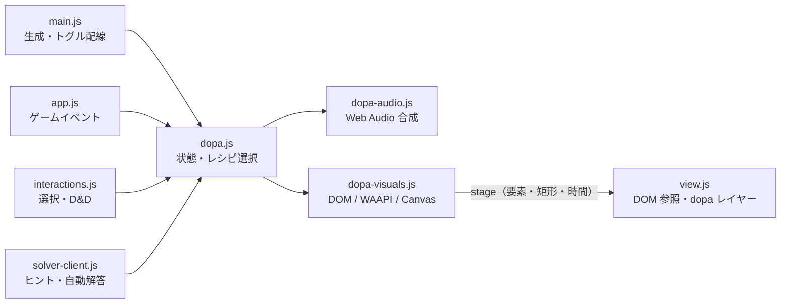

# ドパモード実装計画

## 1. 背景・目的

フリーセル (freecell-classic) は、カードの飛行アニメーション・勝利 / 詰み
オーバーレイ・無効操作時のシェイク程度の演出しか持たず、サウンドは未実装である。
本計画は、グラフィックとサウンドを意図的に派手にするオプション
「ドパモード」を追加するための設計と実装手順を定める。

目的は次の 3 点である。

1. 通常プレイの静かな体験を壊さず、任意で「派手に遊ぶ」選択肢を提供する
2. 依存ライブラリ・ビルド・音声ファイルを増やさず、静的ファイル構成を維持する
3. 既存の状態遷移・自動解答・ソルバー Worker の挙動に影響を与えない

本ドキュメントは実装計画であり、コード変更は含まない。実装は別タスクで行う。

## 2. 決定事項（本人: SH2さん）

以下は本人が決定済みであり、本計画の前提とする。

1. 名称は「ドパモード」とする。
2. ON の場合は `prefers-reduced-motion` 環境でも派手にする。
   通常モードの既存アニメーション無効化ルールはドパモードには適用しない。
3. ツールバーに既存トグルと同形式の単一チェックボックスを置き、
   視覚効果とサウンドをまとめて ON/OFF する。
4. デフォルト OFF、設定は保存しない（既存トグルと同様、再読み込みで初期値）。
5. サウンドは音声ファイルを使わず Web Audio API で合成する。
   AudioContext は最初のユーザー操作時に開始 / 再開する。
6. 対象はプレイ中と勝利時の両方とする。プレイ中はカード選択・移動・着地・
   ホーム送り（連続時の盛り上がりを含む）、勝利時は目玉演出とする。
   失敗・詰みは派手にしすぎず控えめに区別する。
7. 音だけのミュート / 音量調整は初回は作らない（OFF がミュートを兼ねる）。

### 2.1 本計画で追加する設計判断

決定事項に含まれない細部は、次の方針で固定する（レビュー対象）。

- 既存のカード飛行 (`view.js` の `animationsEnabled`) は変更しない。
  reduced-motion 環境でドパモード ON のときも、ドパモード側が独自の
  軌跡アニメーションを描くことで「派手さ」を担保する。
- ドパモードのトグルは演出専用のため、プレイ状態（自動解答中・勝利後を含む）
  でも常に有効とする。ゲーム状態を変えないため `syncControls()` の
  disabled 制御には加えない。
- 自動解答の再生中は、同じ演出を音量・粒子数とも控えめに適用する
  （プレイヤー自身の操作ではないため）。
- 設定はページ内では維持する（新規ゲーム・やり直しで OFF に戻さない）。
  再読み込み時のみ OFF に戻す。

## 3. スコープ

### 3.1 対象（初回実装に含める）

- ツールバーの単一チェックボックス `#dopa-toggle`
- プレイ中の視覚効果（選択・ドラッグ・移動・着地・ホーム送り・失敗・
  アンドゥ・配布・ヒント・自動解答・詰み）
- 勝利時の視覚効果（紙吹雪・花火・ホームの発光）
- Web Audio API による合成サウンド（全イベント共通のマスターゲイン）
- `prefers-reduced-motion` 環境でも ON なら演出する経路
- 単体テスト / E2E テスト / 関連ドキュメントの更新

### 3.2 非スコープ（初回実装に含めない）

- 音量スライダー、個別ミュート、サウンドのみ ON/OFF
- `localStorage` / `sessionStorage` への設定保存
- 音声ファイル（mp3 / ogg / wav）の追加、外部 CDN の利用
- 画面全体の強い揺れ（モーション sickness 配慮のため採用しない）
- カードの絵柄・配色そのものの変更、テーマ切り替え
- ドパモード専用のスコア・実績・設定画面
- ソルバー Worker 側での演出・音声処理
- 既存の通常モード演出の強さの変更

## 4. 現状の実装調査

### 4.1 モジュール構成

本番は `index.html` + `src/css/style.css` + `src/js/*.js` の静的構成で、
ビルド・依存ライブラリはない。関連する責務は次のとおり。

| ファイル | 現在の責務 | ドパモードとの関係 |
| --- | --- | --- |
| `index.html` | ツールバー・盤面・オーバーレイの DOM | トグルを追加する |
| `src/css/style.css` | 盤面・カード・既存演出のスタイル | ドパモード用レイヤーと `.dopa-on` を追加 |
| `src/js/view.js` | DOM 構築・描画・飛行・トースト・勝利画面 | 演出レイヤーと DOM 参照の窓口を追加 |
| `src/js/app.js` | ゲーム開始・状態と View の調停・タイマー | ゲームイベントを dopa へ通知 |
| `src/js/interactions.js` | クリック・Pointer Events・D&D | 選択・ドラッグ・失敗を通知 |
| `src/js/solver-client.js` | ヒント / 自動解答の制御 | ヒント・再生の通知 |
| `src/js/main.js` | 初期化・配線・テスト API | dopa の生成とトグル配線 |
| `src/js/game-state.js` | 純粋な状態遷移 | 変更しない |
| `src/js/rules.js` | 合法手判定・カード位置探索 | `findCardLocation()` を通知に利用 |
| `src/js/solver.js` / `solver.worker.js` | ソルバー本体 / Worker | 変更しない |

### 4.2 既存の演出・状態・設定

- カード移動は「描画は即時、飛行は `#anim-layer` 上のクローン」方式。
  `view.js: render()` が毎回 `cancelActiveFlight()` を呼び、`animGen` で
  古いアニメーション連鎖を中断する（`view.js:134`, `195`）。
- 飛行時間は距離比例で 150〜400ms に clamp される
  （`view.js: flightDuration()`、189 行）。
- `prefers-reduced-motion` は `view.js:135-136` で `animationsEnabled` に
  取り込まれ、`setNextRenderAnimation()` / `animateDragLayerBack()` が
  これを見てアニメーションを省略する。E2E は
  `setAnimationsEnabled(false)` で決定的に動かしている。
- サウンドは未実装。`Audio` / `AudioContext` のコードはリポジトリにない。
- 設定の永続化はない。`auto-move-toggle` は `app.js` の
  `autoMoveEnabled`、`auto-solve-toggle` は `solver-client.js` が状態を持つ。
- ツールバーの disabled は `view.js: syncControls()`（378 行）が一元管理する。
- 勝利 / 詰みは `view.js: showWin()` / `showStuck()`（492 / 503 行）が
  オーバーレイを表示する。
- ヒント / 自動解答は `solver-client.js` の `showHintMove()`（153 行）と
  `startAnimatedReplay()`（103 行）が駆動する。

### 4.3 既存コードへの接続点

行番号は 2026-11-01 時点のもの。実装時は関数名を正とし、行番号は目安とする。

| イベント | 接続点（ファイル: 関数） | 追加する通知 | 通知タイミング |
| --- | --- | --- | --- |
| トグル変更 | `index.html` の `#dopa-toggle` / `main.js: init()` | `dopa.setEnabled()` | render なし（即時） |
| カード選択 | `interactions.js: handleClick()` の選択確定（99-113 行） | `select` | render 後（`view.render(state)` の完了後） |
| 選択解除 | `interactions.js: handleClick()`（84-88 行）、`app.js` の Escape（352-360 行） | `select-cancel` | render 後（同上） |
| ドラッグ開始 | `interactions.js: startDrag()`（156 行） | `drag-start` | render 後 + `buildDragLayer()` / `hideCards()` の後 |
| ドラッグ移動・ドロップ候補変更 | `interactions.js: handlePointerMove()` / `updateDropTargetHighlight()`（247 行） | `drop-target` | render なし（既存要素の更新直後） |
| 移動成功（手動） | `app.js: attemptMove()` → `commitMove()` → `onMoveSucceeded()` | `move`（`source: "manual"`） | render 後（`onMoveSucceeded()` 内） |
| 移動成功（ダブルクリック） | `app.js: dblClickAutoMove()`（223 行） | `move`（`source: "dblclick"`） | render 後 |
| 移動成功（自動解答） | `app.js: applyMoveAnimated()`（145 行） | `move`（`source: "solver"`） | render 後 |
| 自動ホーム送り | `app.js: chainAutoNext()`（103 行） | `home`（`source: "auto-home"`） | render 後（各ステップ） |
| 移動失敗 | `interactions.js: handleClick()`（52-58 / 90-107 行）、`handlePointerUp()`（297-341 行） | `move-fail` | render を伴う分岐は render 後、伴わない分岐は即時 |
| アンドゥ | `app.js: undo()`（169 行） | `undo` | render 後 |
| 新規ゲーム・やり直し | `app.js: startGame()`（270 行） | `reset` → `deal` | `reset` は render 前、`deal` は render 後 |
| ヒント表示 | `solver-client.js: showHintMove()`（153 行） | `hint` | render なし（即時） |
| 自動解答 開始 / 終了 | `solver-client.js: startAnimatedReplay()` / `finishAutoSolve()` | `auto-start` / `auto-end` | render なし（即時） |
| 詰み | `app.js: checkStuck()`（258 行） | `stuck` | render 後（`onMoveSucceeded()` 内） |
| 勝利 | `app.js: checkWin()`（243 行） | `win` | render 後（`onMoveSucceeded()` 内） |
| 勝利オーバーレイを閉じる | `app.js: mount()` の背景クリック（346-350 行） | `win-dismiss` | render なし（即時） |
| 再描画 | `view.js: render()`（49 行） | `render` フック（演出の中断） | render の冒頭（DOM 再生成前） |
| 飛行タイミング | `view.js: playArmedAnimations()`（228 行） / `flightDuration()` | 軌跡演出の duration に利用 | `origins` は render 前、再生は render 後 |

補足:

- **通知タイミングの不変条件**: 要素に紐づく演出（選択リング、残像、
  ホーム発光、対象カードに追従する着地パルス）の通知は、対象要素を
  再生成する `render()` の完了後に発火する。移動前の矩形 (`origins`) だけは
  render 前に取得し、軌跡の再生は render 後に行う。固定座標の画面フラッシュ、
  音、勝利 Canvas はこの限りではない。
- 移動先ゾーンは、成功後の `rules.findCardLocation(state, cardId)` で解決できる。
  移動先の種類（フリーセル / ホーム / カスケード）ごとに音と演出を変えるため、
  通知には `dest` を含める。
- 失敗通知は `view.failFeedback()`（477 行）の呼び出しと対にして
  `interactions.js` 側で行う。View は dopa を知らないままにする。
- トグルは `syncControls()` の対象にしない（演出専用のため、モーダル表示中を
  除いて常時有効）。`#confirm-dialog`、`solution-panel`、`#overlay` は
  全画面のモーダルなので、表示中は既存どおり実質操作できない。

## 5. 全体設計

### 5.1 状態の持ち主

ドパモードの ON/OFF は新規モジュール `src/js/dopa.js` が単一の正とする。

- `dopa.js` が `enabled`、連続ホームの `combo`、演出の世代トークン、
  直近のイベント / レシピ（デバッグ用）を保持する。
- `app.js` / `interactions.js` / `solver-client.js` はゲームイベントを
  `dopa.handle(event)` へ渡すだけで、ON/OFF を自前で持たない。
- ゲーム状態 (`game-state.js`) には一切追加しない。保存もしない。
- `createApp()` / `createInteractions()` / `createSolverClient()` への `dopa` は
  3 関数とも独立プロパティ（`{ ..., dopa = null }`）で注入し、`deps` には
  入れない。未指定時は全メソッドが no-op のオブジェクトを使う。
  既存の単体テスト（`createApp({ view })` など）を壊さない。
- `setEnabled()` は多重呼び出しに耐える（同じ値なら何もしない）。

公開 API（案）:

```js
const dopa = createDopaMode({ view, audio, visuals, env });
dopa.isEnabled();          // boolean
dopa.setEnabled(true);     // トグル・テスト API から
dopa.handle(event);        // 各層からのイベント
dopa.reset(reason);        // 新規ゲーム・アンドゥ・OFF 時の掃除
dopa.debugState();         // E2E 用: enabled / combo / activeEffects など
```

### 5.2 トグルの置き場所

`index.html` の「ヒントと自動解答」グループ（39-45 行）の直後に、
既存の `auto-toggle` と同じ形式で新しい `control-group` を置く。

```html
<div class="control-group" aria-label="演出">
  <label
    class="auto-toggle"
    title="カード移動や勝利時に、光・音・紙吹雪で派手に演出します"
  >
    <input id="dopa-toggle" type="checkbox" autocomplete="off" />
    <span>ドパモード</span>
  </label>
</div>
```

- id 案: `#dopa-toggle`（既存の `#auto-move-toggle` /
  `#auto-solve-toggle` と揃える）。
- クラスは `auto-toggle` を再利用し、見た目を揃える。
- `checked` は付けない（デフォルト OFF）。ブラウザーがリロード時に
  フォーム状態を復元する場合に備え、`autocomplete="off"` を付け、
  さらに `main.js: init()` で `toggle.checked = dopa.isEnabled()` を明示する。
- ラベルは `aria-label="演出"` のグループに入れ、チェックボックス自体は
  ネイティブの ON/OFF を読み上げに任せる。追加の `aria-pressed` は不要。

### 5.3 モジュール分割案

新規ファイルは 3 つとし、責務を分ける。

| 新規ファイル | 責務 | 依存 |
| --- | --- | --- |
| `src/js/dopa.js` | モード状態、イベント→演出レシピの対応、連続ホームの combo、強度の決定、掃除の指示 | `dopa-audio.js`, `dopa-visuals.js`（注入） |
| `src/js/dopa-audio.js` | Web Audio の生成・再開・停止、音色レシピ、同時発音数、マスターゲイン | Web Audio API のみ |
| `src/js/dopa-visuals.js` | DOM / Web Animations / Canvas の演出実行、粒子数上限、RAF、掃除 | View から渡される stage のみ |



#### 5.3.1 `dopa.js`（コントローラー）

- `createDopaMode({ view, audio, visuals, env })`
- `setEnabled(on)`: `view.setDopaMode(on)`、`audio.setEnabled(on)`、
  OFF 時は `reset("disabled")`。ON 時は `audio.unlock()`。
- `handle(event)`: イベント種別・移動先・`source`・combo から
  強度（`calm` / `normal` / `max`）とレシピを決め、
  `visuals.*` と `audio.play()` を呼ぶ。未知イベントは無視する。
- combo: `home` イベントが前回から `COMBO_WINDOW_MS = 900` 以内なら
  加算し、それ以外は 1 に戻す。音程は `min(combo - 1, 12)` 半音
  （初回は +0 半音 = C5）、発光強度は `min(combo, 12)` を使う。
  `move`（ホーム以外）・`move-fail`・`undo`・`deal` でリセットする。
- `env`: `{ reducedMotion, mobile, deviceMemory, now }` を注入可能にし、
  単体テストで固定する。`reducedMotion` は「抑止しない」判断の記録用で、
  演出の ON/OFF には使わない。
- `reset(reason)`: `visuals.cancelAll()`、`audio.stopAll()`、combo リセット、
  世代トークン加算。

#### 5.3.2 `dopa-audio.js`（サウンド）

- `createDopaAudio({ AudioContextCtor, now })`。`AudioContextCtor` を注入可能に
  し、Node の単体テストでは fake を渡す。
- API: `unlock()` / `play(recipe, opts)` / `setEnabled(on)` /
  `stopAll({ fadeMs })` / `getDebugState()`。
- 音声ファイル・外部ライブラリは使わない。詳細は 8 章。

#### 5.3.3 `dopa-visuals.js`（視覚効果）

- `createDopaVisuals({ stage })`。`stage` は `view.js` が返す次の窓口。
  `dopa-visuals.js` は `document.querySelector` を使わず、既存要素の探索を
  View に閉じ込める。
- `stage` の契約（案）:

```js
// view.js: getDopaStage() の返り値
{
  layer,                       // #dopa-layer（View が遅延生成）
  getWinLayer(),               // #dopa-win-layer（勝利時だけ遅延生成）
  getCardEl(cardId),           // 既存 cardElById()
  getSlotEl(zone, index),      // free / home / cascade の要素
  getRect(el),                 // getBoundingClientRect()
  getFlightDuration(dist),     // 既存 flightDuration()
  getViewport(),               // { width, height, dpr }
}
```

- API: `flightTrail()` / `landingBurst()` / `homeGlow()` /
  `selectionPulse()` / `dragLift()` / `failFlash()` / `dealSparkles()` /
  `hintRings()` / `undoRipple()` / `stuckVignette()` / `winCelebrate()` /
  `cancelAnchored()` / `cancelAll()` / `setEnabled()` / `getDebugState()`。
- レイヤーは 2 つに分ける。
  - `#dopa-layer`: プレイ中の DOM 演出用。
    `position: fixed; inset: 0; pointer-events: none; z-index: 1600`
    （既存 `#anim-layer` の 1500 より上、`.overlay` の 2000 より下）。
  - `#dopa-win-layer`: 勝利の Canvas 専用。
    `position: fixed; inset: 0; pointer-events: none; z-index: 2100`。
    勝利オーバーレイ (`.overlay` = 2000) より上、解答パネル
    (`solution-panel` = 2500) と `#toast` (3000) より下に置く。
    これにより紙吹雪・花火が 60% の黒幕越しにならず、「最大」の
    目玉演出として成立する。
- オーバーレイカードの可読性は、粒子が一過性で 4.5 秒後に終了すること、
  粒子を小さめ・半透明にし、花火を画面上半分に寄せることで確保する。
  ダイアログを覆う時間は短く、操作は `pointer-events: none` で妨げない。
- プレイ中のレイヤーは DOM 演出用コンテナ、勝利レイヤーは `<canvas>` だけを
  持つ。Canvas は勝利開始時に生成し、終了時に削除する。

#### 5.3.4 View の追加 API

`src/js/view.js` に次を追加する（既存の return オブジェクトへ）。

- `getDopaStage()`: 上記の stage を返す。
- `setDopaMode(on)`: `document.body.classList.toggle("dopa-on", on)`。
- `onBeforeRender(fn)`: `render()` の冒頭（`cancelActiveFlight()` の直後）で
  呼ぶフックを 1 つ登録する。`dopa-visuals` の位置依存演出（残像・リング）を
  中断するために使う。固定座標の着地バーストは自然終了させる。
  フック内の例外は `try/catch` で握りつぶし、描画を止めない。
- `flightDuration(dist)`: 既存の内部関数を公開し、軌跡演出の時間を揃える。
- `#dopa-layer` と `#dopa-win-layer` の遅延生成。

既存の `animationsEnabled` / `setAnimationsEnabled()` / `animGen` の意味は
変更しない。

### 5.4 初期化と配線

`main.js: init()` の生成順を次のようにする。

```js
const view = createView();
const dopa = createDopaMode({ view });
const app = createApp({ view, dopa });          // deps は既存のまま
const interactions = createInteractions({ view, app, dopa });
app.mount(interactions);
solverClient = createSolverClient({ app, view, dopa });
```

注入方法は 3 関数とも独立プロパティ `dopa` に統一する。`deps` は
`createApp()` のテスト用差し替え（`now` / `setInterval` など）専用のまま
残し、ドパモードを混ぜない。署名は次の形になる。

```js
createApp({ view, dopa = null, deps = {} });
createInteractions({ view, app, dopa = null });
createSolverClient({ app, view, dopa = null });
```

`dopa` を省略した既存呼び出しは、5.1 の no-op 実装でそのまま動く。

トグルは `main.js: init()` で次のように配線する。

```js
const dopaToggle = document.getElementById("dopa-toggle");
dopaToggle.checked = dopa.isEnabled();
dopaToggle.addEventListener("change", () => {
  dopa.setEnabled(dopaToggle.checked);
});
```

- `createDopaMode` は内部で `createDopaAudio()` と
  `createDopaVisuals({ stage: view.getDopaStage() })` を生成する。
- AudioContext の `unlock()` は、トグル ON の change イベント
  （ユーザー操作）と、ON 中の最初の `pointerdown` / `keydown` で行う。
- 既存の `clearSolutionOnNewGame()` には変更を加えない。
  新規ゲーム時の `reset` / `deal` は `app.startGame()` が通知する。

### 5.5 イベントの形

各層から渡すイベントの共通形（案）:

```js
{
  type: "select" | "select-cancel" | "drag-start" | "drop-target" |
        "move" | "home" | "move-fail" | "undo" | "deal" |
        "hint" | "auto-start" | "auto-end" | "stuck" | "win" |
        "win-dismiss" | "reset",
  source: "manual" | "dblclick" | "auto-home" | "solver",
  cardId, cardIds,                 // 対象カード
  from, dest,                      // { zone, index, cardIndex? }
  origins,                         // cardId -> 移動前の矩形
  duration,                        // 軌跡演出の時間（ms）
  reason,                          // "invalid" | "too-many" | ...
  combo,                           // dopa 側で付与
}
```

- `app.onMoveSucceeded(meta)` に `meta` を追加し、`view.render(state)` の後で
  `dopa.handle()` を呼ぶ。`meta` には `source`・`cardIds`・`origins` を入れ、
  移動先は `rules.findCardLocation(state, cardId)` で解決する。
- `chainAutoNext()` は 1 枚送るたびに `source: "auto-home"` の `home` を通知する。
- `applyMoveAnimated()` は `source: "solver"` の `move` を通知する。
- `undo()` / `checkStuck()` / `checkWin()` は、既存の `view.*` 呼び出しの
  直後に通知する。`startGame()` は `view.render(state)` の前に `reset`、
  後に `deal` を通知する（4.3）。
- `handleClick()` / `handlePointerUp()` の失敗分岐は、既存の
  `view.failFeedback()` / `view.showToast()` と並べて通知する。
- 要素に紐づく演出は 4.3 の「通知タイミングの不変条件」に従い、
  対象要素を再生成する `view.render()` の後に通知する。軌跡の `origins`
  だけは移動前に取得し、再生は render 後に行う。

## 6. イベント別マトリクス

強さの目安: 控えめ = 音・光とも小さく短い / 通常 = プレイの主演出 /
最大 = 勝利の目玉演出。粒子数・音量の具体値は 7・8 章の上限に従う。

| イベント | 発火元 | 視覚効果 | サウンド | 強さ |
| --- | --- | --- | --- | --- |
| カード選択 | `handleClick()` の選択確定 | 選択カードに金のリングパルス（1 回、220ms） | 短い 2 音の「コッ」（sine 880+1320Hz、45ms） | 控えめ |
| 選択解除 | 同カード再クリック / Escape / 非 grabbable | リングを即座に消す（新規演出なし） | なし | 控えめ |
| ドラッグ開始 | `startDrag()` | ドラッグ中のカードに浮遊感（影・1.03 倍、CSS） | フィルター付きノイズの「シュッ」（120ms） | 通常 |
| ドラッグ移動・ドロップ候補変更 | `handlePointerMove()` / `updateDropTargetHighlight()` | 既存 `.drop-target` に金の脈動を追加。毎フレームの粒子は出さない | 候補が変わったときだけ、ごく短いクリック音（20ms、100ms 間引き） | 控えめ |
| 移動成功（カスケード） | `attemptMove()` 成功 | 軌跡 3 残像 + 着地バースト 8 粒子 | 2 音の上昇（392→523Hz、90ms） | 通常 |
| 移動成功（フリーセル） | 同上（`dest.zone==="free"`） | 水色の小バースト 6 粒子 | sine 660→880Hz、80ms | 通常 |
| 移動成功（ホーム） | 同上（`dest.zone==="home"`） | 金のバースト + ホーム発光 + 軌跡 | アルペジオ（C5-E5-G5、140ms） | 通常 |
| 着地（共通） | 移動成功の着地時 | 対象カード / スロットの輪郭パルス（250ms） | 低い「トン」+ 短いノイズ（60ms） | 控えめ |
| 移動失敗（不正） | `failFeedback()` の呼び出し | 赤いビネットの一瞬の明滅（250ms） | 低い矩形波 180→120Hz（140ms） | 控えめ |
| 移動失敗（枚数超過） | 同上（`reason==="too-many"`） | 琥珀色のビネット + 既存シェイク | 上記を 2 回（90ms 間隔） | 控えめ |
| 自動ホーム送り 1 枚目 | `chainAutoNext()` | ホーム発光 + 金バースト | ホーム用アルペジオ | 通常 |
| 自動ホーム送り連続 | 連続する `home`（900ms 以内） | 発光半径・粒子数を段階増加（上限あり） | 初回 C5 から半音ずつ、最大 +12 半音 | 通常→最大 |
| アンドゥ | `undo()` | 盤面中央に青い波紋（300ms）+ 対象カードの輪郭 | 下降 3 音（523→392→330Hz、160ms） | 控えめ |
| 新規ゲーム・やり直しの配布 | `startGame()` | 配布位置に 16 個の星屑（モバイル 8）+ 全体の金フラッシュ | カードのリフル（ノイズ 3 連）+ 上昇音 | 通常 |
| ヒント表示 | `showHintMove()` | 既存の緑ハイライトに脈動リングを追加（2 箇所、900ms） | ベル（1046+1568Hz、300ms 減衰） | 控えめ |
| 自動解答の再生中 | `applyMoveAnimated()` | 通常の移動演出を粒子 50%・残像 2 個に縮小 | 移動音を低域寄り・音量 50% に | 控えめ |
| 自動解答の開始 / 終了 | `startAnimatedReplay()` / `finishAutoSolve()` | 盤面全体のごく薄い走査ライン（任意） | 柔らかい 2 音のコード | 控えめ |
| 詰み | `checkStuck()` | 画面周辺の暗いビネット（900ms、赤みなし） | 低い短三度（220+207.65Hz、400ms） | 控えめ |
| 勝利 | `checkWin()` | `#dopa-win-layer` の Canvas で紙吹雪 + 花火 3 発 + ホーム発光 + 金の全面グロー（オーバーレイより上） | ファンファーレ + 花火ノイズ + 低音 | 最大 |
| 勝利オーバーレイを閉じる | `mount()` の背景クリック | 紙吹雪・花火をフェードアウト | 残響を 150ms でフェード | 控えめ |

補足:

- combo の「段階的上昇」は音程だけに依存させず、ホームの発光半径と
  粒子数も同時に上げる。視覚・聴覚の両方で連続感を出す。
- 自動解答の再生は `source: "solver"` で判別し、combo の対象外とする
  （ソルバーの手順でホームに送られても「プレイヤーの連続技」にはしない）。
- 詰みは「失敗」と区別できるよう、赤ではなく暗いビネットと短三度を使う。
- 勝利演出は 4.5 秒で自動終了する。オーバーレイを閉じた場合、新規ゲーム、
  OFF、アンドゥ相当のリセットでも即座に止める。

## 7. 視覚効果の技術方式

### 7.1 方式の選定

| 用途 | 採用方式 | 理由 |
| --- | --- | --- |
| 軌跡の残像 | DOM クローン + Web Animations API | 既存の飛行クローンと同じ見た目を再利用でき、`transform` だけで動かせる。カードの DOM を複製するため絵柄の再実装が不要 |
| 着地バースト | DOM の小要素 + Web Animations API | 1 回 6〜10 個と少なく、ノードの生成・削除が単純。GPU 合成される `transform` / `opacity` のみ使う |
| ホーム発光 | 既存要素への CSS クラス + `@keyframes` | 要素 1 つの `box-shadow` / `filter` で済み、DOM を増やさない |
| 紙吹雪・花火 | Canvas 2D + `requestAnimationFrame` | 粒子が 100〜240 個と多く、DOM ノードを大量に作る方式はレイアウト・GC に不利。1 枚の canvas なら描画コストを制御しやすい。専用レイヤー `#dopa-win-layer`（z-index 2100）に置き、オーバーレイの暗幕より上で描く |
| 選択リング・失敗フラッシュ・波紋 | 既存要素の CSS / WAAPI、固定位置の 1 要素 | 単発・短時間で、DOM 追加を最小にできる |

不採用:

- 全演出を CSS アニメーションだけで表現する方式は、移動先の座標・粒子数・
  combo に応じた動的生成が不得意で、クラス名の組合せが爆発する。
- 全演出を Canvas にする方式は、カードの絵柄・文字を再描画する必要があり、
  既存 DOM との一致・アクセシビリティの面で不利。
- SVG アニメーションは、カードのクローン再利用と座標系の一致が面倒。

### 7.2 各演出の実装方式

- 軌跡: `view.getCardEl(cardId)` の複製を `#dopa-layer` に置き、
  `anim-hidden` / `selected` / `movable` / `shake` / `drag-hidden` を外す。
  元の位置から移動先まで、0 / 30 / 60ms ずらして `translate` し、
  opacity を 0.35 → 0 に落とす。時間は `stage.getFlightDuration(dist)`。
  1 枚あたり最大 3 個、1 イベント最大 8 枚（24 ノード）。
- 着地バースト: 移動先の中心から放射状に 6〜10 個の小片を飛ばす。
  色はスート色（赤 / 黒）と金の混合。`transform` + `opacity` のみ。
- ホーム発光: `homeSlotEls[index]` に `.dopa-home-glow` を 300〜400ms 付与。
  combo に応じて `box-shadow` の広がりを CSS 変数 `--dopa-glow` で変える。
- 配布: カード要素の矩形を 16 点（モバイル 8 点）サンプリングし、
  上から小さな光を落とす。52 枚全部には付けない。
- ヒント: `hint-source` / `hint-target` の要素にリングを 2 つ重ねる。
  既存の 10 秒自動消去 (`HINT_AUTO_HIDE_MS`) とは独立に 900ms で消える。
- 勝利: `stage.getWinLayer()` に canvas を 1 枚生成し、
  紙吹雪（上から落下・回転）と花火（t=0 / 350 / 700ms に放射状バースト）を
  描く。最後の 500ms で全体の alpha を落として消す。DPR は 2 で頭打ちにする。
  レイヤーは `z-index: 2100`（オーバーレイ 2000 より上、解答パネル 2500 と
  `#toast` 3000 より下）、`pointer-events: none`。粒子は小さめ・半透明にし、
  花火は画面上半分に寄せて、オーバーレイカードの文字を覆い続けない。

### 7.3 生成物の上限と掃除

上限（デスクトップ / モバイル）:

| 対象 | デスクトップ | モバイル・低メモリ |
| --- | --- | --- |
| 同時に存在する DOM 演出ノード | 32 | 20 |
| 軌跡の残像 | 3 個 × 8 枚 = 24 | 2 個 × 6 枚 = 12 |
| 着地バーストの粒子 | 10 | 6 |
| 配布の星屑 | 16 | 8 |
| 勝利の紙吹雪・花火の粒子 | 180（花火 3×20 を含む） | 90（花火 3×12） |
| 同時 Web Animations | 32 | 20 |
| 同時発音（8 章） | 12 | 8 |

掃除の原則:

1. 生成したノードはすべて `Set` に登録し、`animation.finished` /
   `animation.cancel()` / タイマー終了のいずれでも `remove()` する。
2. `try/finally` で、例外時もノードと `will-change` を残さない。
3. Canvas は `cancelAnimationFrame()`、`canvas.width = 0`、
   `canvas.remove()` まで行う。`#dopa-win-layer` に残る子要素も空にする。
   RAF の参照も null にする。
4. 上限を超える新規演出は「勝利 > ホーム > 移動 > 選択」の優先度で
   落とす。勝利演出の開始時は、一時的な DOM 演出を先に消して枠を空ける。
5. `document.visibilityState === "hidden"` になったら、Canvas の RAF を
   停止し、一時演出を消す。復帰時に過去の演出を再生し直さない。

### 7.4 再描画・新規ゲーム時のキャンセル

既存の `view.js` は `animGen` を増やして古い飛行連鎖を中断する
（`cancelActiveFlight()`、195 行）。ドパモードも同じ「世代トークン」方式を
`dopa-visuals.js` 内に持つ。

- `dopaGen` を `cancelAnchored()` / `cancelAll()` でインクリメントする。
- 各演出の非同期チェーンは開始時の `gen` を保持し、`await` の後で
  `gen !== dopaGen` なら何もせず抜ける。既存の `playArmedAnimations()` の
  世代チェック（299 行）と同じ考え方。
- `view.onBeforeRender()` に `visuals.cancelAnchored()` を登録する。
  選択・移動・リサイズなどで `render()` が走ったとき、カード要素の位置に
  依存する残像・リングだけを消す。固定座標で動く着地バーストや画面フラッシュ、
  音、勝利 Canvas（`#dopa-win-layer`）は自然終了させる。
- `app.startGame()` / `app.undo()` / トグル OFF では `dopa.reset()` を呼び、
  `cancelAll()`（Canvas・音・combo・バーストを含む）を行う。
- 基底の飛行 (`animGen`) とドパの `dopaGen` は独立させる。ドパ OFF が
  既存の飛行を中断したり、既存の再描画が音を止めたりしない。

## 8. サウンド設計

### 8.1 AudioContext のライフサイクル

- `AudioContext` は最初のユーザー操作まで生成しない。
  生成契機は「トグル ON の change イベント」または「ON 中の最初の
  `pointerdown` / `keydown`」。
- 生成時に `masterGain`（初期 0）と `DynamicsCompressorNode` を
  1 回だけ作り、`masterGain → compressor → destination` に接続する。
- `unlock()` は `ctx.state === "suspended"` なら `ctx.resume()` を呼ぶ。
  `resume()` の Promise は待たず、失敗（自動再生制限）でも例外を投げない。
  失敗時は音だけ諦め、視覚演出は継続する。
- ON にした直後は `masterGain` を 30ms で通常値（0.22）へランプする。
- タブが非表示になったら `ctx.suspend()` し、次のユーザー操作で再開する。
- ブラウザー差異: `window.AudioContext ?? window.webkitAudioContext` を
  フォールバックにする。どちらも無ければ `isAvailable() === false` の
  no-op 実装になる。

### 8.2 ノード構成とエンベロープ

1 音（voice）の基本構成:

```text
OscillatorNode / AudioBufferSourceNode
  → BiquadFilterNode（必要な音色のみ）
  → GainNode（ADSR の A/D）
  → masterGain → compressor → destination
```

- 波形: 選択・移動・ホーム・ヒントは `sine` / `triangle`、
  失敗は `square` を低音量・低域フィルターで使う。
- ノイズ: 起動時に 1 秒のホワイトノイズ `AudioBuffer` を 1 つ生成し、
  ドラッグ・着地・配布・花火で `AudioBufferSourceNode` として再利用する。
- エンベロープ:
  `gain.setValueAtTime(0.0001, t)` →
  `exponentialRampToValueAtTime(peak, t + attack)` →
  `exponentialRampToValueAtTime(0.0001, t + decay)`。
  attack は 3〜15ms、decay は音色ごとに 40〜600ms。
- `source.stop(t + length)` を必ず呼び、`onended` で `disconnect()` する。
- マスターゲインは 0.22、コンプレッサーは threshold -18dB / ratio 4 を
  目安にし、連打時のクリッピングを防ぐ。

### 8.3 イベント別の音のレシピ案

| イベント | 波形 / 素材 | 周波数・フィルター | 長さ | 音量の目安 |
| --- | --- | --- | --- | --- |
| 選択 | sine × 2 | 880Hz + 1320Hz | 45ms | 0.05 |
| ドラッグ開始 | noise | bandpass 800→1600Hz のスイープ | 120ms | 0.05 |
| ドロップ候補 | triangle | 1200Hz | 20ms | 0.025 |
| 移動（カスケード） | triangle | 392→523Hz | 90ms | 0.06 |
| 移動（フリーセル） | sine | 660→880Hz | 80ms | 0.05 |
| 移動（ホーム） | triangle × 3 | C5-E5-G5 のアルペジオ | 140ms | 0.07 |
| 着地 | sine + noise | 150Hz + 短いクリック | 60ms | 0.05 |
| 失敗（不正） | square | 180→120Hz、lowpass 600Hz | 140ms | 0.035 |
| 失敗（枚数超過） | square | 上記を 2 回 | 90ms 間隔 | 0.035 |
| アンドゥ | sine | 523→392→330Hz | 160ms | 0.05 |
| 配布 | noise + triangle | ノイズ 3 連 + 523→784Hz | 300ms | 0.06 |
| ヒント | sine × 2 | 1046Hz + 1568Hz、長い減衰 | 300ms | 0.05 |
| 自動解答 開始 | triangle × 2 | 392Hz + 494Hz | 200ms | 0.04 |
| 自動解答 終了 | triangle × 2 | 523Hz + 659Hz | 250ms | 0.04 |
| 自動解答の 1 手 | 移動音を流用 | lowpass 1800Hz、音量半減 | 90ms | 0.03 |
| 詰み | sine × 2 | 220Hz + 207.65Hz（短三度） | 400ms | 0.035 |
| 勝利 | triangle + noise + sine | 523 / 659 / 784 / 1046Hz の順次 + 花火 + 131Hz | 1.2s | 0.10 |
| トグル ON | triangle × 2 | 659Hz + 880Hz | 80ms | 0.05 |
| トグル OFF | sine | 440→330Hz | 100ms | 0.04 |

音量は masterGain 0.22 に対する voice の peak の目安。実際の値は
実装時にヘッドホンで調整し、0.22 を超える masterGain にはしない。

### 8.4 連続ホーム時の音程上昇

- `home` イベントの間隔が 900ms 以内なら combo を +1 する（初回は 1）。
- 音程の段階は `n = min(combo - 1, 12)` とし、ルート音を
  `523.25 * 2 ** (n / 12)` Hz にする。初回 (combo=1) は C5 そのもの、
  13 回目以降は +12 半音（1 オクターブ上）で頭打ちにする。
- アルペジオの 3 音はルートの長三和音（+4 半音、+7 半音）にする。
- combo 13 以降は同じ音程を繰り返す（際限ない上昇を防ぐ）。
- 視覚側も `--dopa-glow` を combo に比例して上げ、粒子数を
  `6 + min(combo, 8)` にする（上限 14）。
- 自動解答 (`source: "solver"`) と、900ms を超えた移動では combo を
  1 に戻す。

### 8.5 同時発音数の上限と OFF 時の扱い

- 同時 voice は 12（モバイル 8）。超える場合は新しい音を間引く。
  失敗音・詰み音などの重要音は残し、装飾音（ドロップ候補・着地）から落とす。
- voice は `stop()` 後に必ず `disconnect()` し、参照を `Set` から外す。
- `setEnabled(false)` の瞬間:
  1. 新規 `play()` を無効化する
  2. `masterGain` を 50ms で 0 へランプ
  3. 60ms 後に全 source を `stop()`、`disconnect()`
  4. 120ms 後に `ctx.suspend()`（次回 ON で再開）
- OFF 中にイベントが来ても、AudioContext を再生成しない。
- `pagehide` でも `stopAll()` を呼び、ゾンビ voice を残さない。

## 9. `prefers-reduced-motion` 方針

- 通常モードの既存挙動は変更しない。`view.js` の `animationsEnabled`
  （135-136 行）と `setAnimationsEnabled()` はそのまま。
- ドパモードの視覚効果は `matchMedia("(prefers-reduced-motion: reduce)")` を
  参照しない。ON なら常に実行する（決定事項 2）。
- ドパモード用 CSS はすべて `.dopa-on` 配下に置き、既存の
  `@media (prefers-reduced-motion: reduce)` ルール（例:
  `#hint-btn.busy::before`、179-183 行）には触れない。
- 既存の飛行アニメーションは reduced-motion 環境では従来どおり省略される。
  その場合でもドパモードは、`origins` と移動先矩形から独自の残像を
  150〜400ms で描くため、動きのない画面にはならない。
- この上書きは「ユーザーが自分でドパモードを ON にした」場合に限定される。
  デフォルト OFF により、意図しない派手な動きは発生しない。
- 画面全体の強い揺れは reduced-motion の有無にかかわらず採用しない
  （酔い・読みづらさを避けるため）。揺れは既存のカード単体 shake に留める。

## 10. パフォーマンス配慮

- 粒子数・同時アニメーション数は 7.3 の上限表で固定する。
  上限判定は `dopa-visuals.js` が持ち、`dopa.js` は強度だけを決める。
- モバイル判定は `matchMedia("(max-width: 600px)")` と
  `navigator.deviceMemory <= 4` の OR とし、粒子数・voice 数を半減する。
  既存の `@media (max-width: 600px)`（style.css:600 行〜）と基準を揃える。
- アニメーションは `transform` / `opacity` / `filter` のみを使い、
  `top` / `left` / `width` / `height` の連続変更を避ける。
  `will-change` は演出中だけ付け、終了時に外す。
- 矩形計測 (`getBoundingClientRect`) は 1 イベントにつき 1 回にまとめ、
  ループ内で繰り返さない。`render()` 後の 1 フレームで測る。
- `document.visibilityState === "hidden"` では Canvas の RAF を止め、
  音声を suspend する。`window` の `resize` 中は新しい大規模演出を抑制する。
- ソルバー Worker への影響:
  - `dopa-*.js` は `solver.js` / `solver.worker.js` から import しない。
  - ソルバーの `onmessage` 処理中に同期の重い処理を足さない。
  - 演出は `requestAnimationFrame` と Web Animations に限定し、
    Worker の計算と同じスレッドを長時間ブロックしない。
- メモリ: ノード・Animation・voice はすべて `Set` で管理し、
  終了時に参照を切る。ゲームを 10 回繰り返しても増加しないことを
  手動確認の項目に入れる。

## 11. 状態遷移への影響

### 11.1 `docs/ui-state-matrix.md` の観点

ドパモードはゲーム状態を変えない「表示設定」である。したがって
`view.js: syncControls()` の disabled 制御には加えず、モーダル表示中を除き
全状態で有効とする。既存のモーダル（`#confirm-dialog`、`solution-panel`、
`#overlay`）が表示中のときは、物理的にツールバーが覆われるため操作できない
（既存挙動）。

### 11.2 状態別の振る舞い

| 状態 | `#dopa-toggle` | 演出の振る舞い |
| --- | --- | --- |
| アイドル（通常） | ◎ | 全イベントを通常強度で再生 |
| 詰み | ◎ | 詰み演出は控えめ。OFF で即停止。アンドゥでリセット |
| 勝利 | ×（オーバーレイ表示中）／◎（閉じた後） | 勝利演出はオーバーレイより上の `#dopa-win-layer` で再生し、4.5 秒で終了。OFF・新規ゲーム・オーバーレイを閉じるで停止 |
| ヒント計算中 | ◎ | 盤面は操作可能。ヒント表示時にヒント音 |
| 自動解答 計算中 | ◎ | 計算中はゲームイベントが無いため演出なし。OFF にしても計算は継続 |
| 自動解答 再生中 | ◎ | 各手を控えめに演出。OFF にすると以降の演出だけ停止し、自動解答は継続 |
| やり直し確認ダイアログ | ×（モーダルが覆う） | 新規演出なし。既存の短い演出は自然終了 |
| 解答手順パネル | ×（モーダルが覆う） | パネル表示中の新規演出なし |
| アニメーション中 | ◎ | OFF はドパ演出だけ即停止。既存のカード飛行は継続 |

補足:

- ON にした瞬間から次のイベントに適用する。再生中の演出を途中から
  強くすることはしない（途中変更のちらつきを避ける）。
- OFF にした瞬間に鳴っている音は 8.5 のフェードで止める。
  既存のカード飛行・トースト・オーバーレイは止めない。
- 自動解答の再生中に OFF にしても `autoSolving` や `solver-client.js` の
  状態には触れない。演出だけの停止であることを保証する。
- 実装フェーズで `docs/ui-state-matrix.md` を更新する:
  - 3 章のコントロール一覧に `dopa-toggle` を追加
  - 4 章に「演出設定」の節を追加し、モーダル表示中を除き ◎ である理由を明記
  - 2.3 のアプリ排他状態に「ドパモードはゲーム状態に影響しない」と注記
  - 必要なら状態遷移図に「演出のみ」の注記を追加（ノードは増やさない）

## 12. テスト計画

### 12.1 単体テスト（Vitest）

新規 `tests/unit/dopa-audio.test.js`:

- `AudioContext` の fake を注入し、`unlock()` まで context を生成しない。
- `play()` が指定の波形・周波数・エンベロープで
  Oscillator / Gain / Filter を生成し、`start()` / `stop()` する。
- 同時発音上限を超えたら新規 voice を間引き、例外を出さない。
- `setEnabled(false)` で masterGain が 0 へランプし、voice が停止する。
- `ctx.state === "suspended"` のとき `resume()` を呼ぶ。
  `resume()` が reject しても `play()` が throw しない。
- `AudioContext` が存在しない環境（Node）で no-op になり、
  `isAvailable() === false` を返す。
- OFF 中の `play()` が AudioContext を再生成しない。

新規 `tests/unit/dopa.test.js`:

- デフォルトが OFF で、`handle()` が何もしない。
- `setEnabled(true/false)` が View / Audio / Visuals の
  `setEnabled` と `reset` を正しい順で呼ぶ。
- イベント→レシピの対応:
  - `move` + `dest.zone === "home"` → ホーム音・ホーム発光
  - `move` + `dest.zone === "free"` → フリーセル音
  - `move-fail` → 失敗音・ビネット
  - `source === "solver"` → 自動解答用の控えめレシピ
- combo が 900ms 以内で増加し、時間経過・`undo`・`deal`・
  ホーム以外の移動でリセットされる。12 で頭打ちになる。
- `env.reducedMotion === true` でも Visuals が呼ばれる。
- モバイル env で粒子数・voice 数の上限が下がる。
- `reset()` が `cancelAll()` と combo リセットを行う。
- 未知イベント・`dopa` 未指定の `createApp()` が壊れない。

既存の `tests/unit/app.test.js` は `view` モックに dopa 関連の
メソッドを追加しなくても通る（`dopa` 省略時の no-op 経路）。

### 12.2 E2E テスト（Playwright）

新規 `tests/e2e/dopa-mode.spec.js` と `tests/e2e/helpers.js` の拡張。

1. デフォルト OFF:
   - `#dopa-toggle` が unchecked
   - `body` に `.dopa-on` が無い
   - `#dopa-layer` が無い、または子要素 0
   - `#dopa-win-layer` が無い
   - `dopaDebug().enabled === false`
2. ON/OFF の切り替え:
   - トグルをクリック → `checked`、`body.dopa-on`、`#dopa-layer` が存在
   - カード選択・移動で `#dopa-layer` に演出ノードが現れる
   - もう一度クリック → `.dopa-on` が消え、演出ノードが 0 になる
3. 再読み込みで OFF:
   - ON にした後に `page.reload()` → `#dopa-toggle` が unchecked
4. reduced-motion エミュレート:
   - `page.emulateMedia({ reducedMotion: "reduce" })` で開く
   - トグル ON → 移動 → `#anim-layer` は空（既存飛行は無効）でも
     `#dopa-layer` に残像 / バーストが出る
5. 勝利演出:
   - `setWinBoard()` → `#dopa-win-layer canvas` が存在し、
     `dopaDebug().activeEffects > 0`
   - canvas の `z-index` が `.overlay` (2000) より大きいこと、
     `pointer-events: none` であることを確認する
   - オーバーレイを閉じる / 新規ゲーム / OFF で canvas が消える
6. OFF の掃除:
   - 勝利演出中に OFF → 300ms 以内に `activeEffects === 0`、
     `#dopa-layer` と `#dopa-win-layer` の子要素が 0、音声 voice が 0
7. 音声の自動再生制限:
   - `page.addInitScript` で `AudioContext` の生成・`resume()` を記録する
   - 操作前は context 未生成、トグル ON のクリック後に生成・resume される
8. 既存機能の回帰:
   - `npm test` が全成功する
   - ドパモード OFF で既存の E2E が全て通る（既存テストは触らない）

E2E 用の追加 API（`main.js: getTestApi()`）:

```js
setDopaEnabled(enabled); // app 経由で dopa.setEnabled()
isDopaEnabled();
dopaDebug();             // { enabled, combo, activeEffects, activeVoices, lastRecipe }
```

- 既存テストは `setAnimationsEnabled(false)` のまま。ドパモードの検証は
  その状態でも動く必要がある（reduced-motion 相当の経路の確認を兼ねる）。
- 時間待ちは固定 `waitForTimeout` ではなく、
  `dopaDebug().activeEffects === 0` の `waitForFunction` を使う。
- 音声は実音を検証せず、fake AudioContext の呼び出し回数で検証する
  （CI のヘッドレス環境で音声デバイスに依存しない）。

### 12.3 手動確認

- Chrome / Firefox / Safari（可能なら iOS Safari）で、
  トグル ON → 移動 → ホーム連続 → 勝利を通しで確認する。
  勝利時は紙吹雪・花火がオーバーレイの上で見え、
  ダイアログの文字が読めることを確認する。
- OS の「視差効果を減らす / 動きを減らす」を ON にしても、
  ドパモード ON で演出されることを確認する。
- 自動解答の計算中・再生中にトグルを OFF/ON し、自動解答が
  止まらないことを確認する。
- タブを背景に送って戻り、RAF・音声・ノードが残らないことを確認する。
- DevTools の Performance / Memory で、勝利演出後に
  DOM ノード数と Animation 数が元に戻ることを確認する。
- スマートフォン幅（600px 以下）で粒子数が減り、
  操作が重くならないことを確認する。

### 12.4 品質ゲート

各フェーズの完了時に次を必須とする。

```bash
npm run test:unit
npm run test:e2e
npm test
```

- 単体・E2E とも全成功すること。
- ブラウザーのコンソールに未捕捉例外・AudioContext の警告以外の
  エラーが出ないこと。
- 実装フェーズでは `README.md` / `CHANGELOG.md` /
  `docs/ui-state-matrix.md` の更新も完了条件に含める。

## 13. 実装フェーズ分け

### Phase 1: 基盤

内容:

- `index.html` に `#dopa-toggle` を追加
- `style.css` に `.dopa-on`、`#dopa-layer`、`#dopa-win-layer`、
  Canvas の基本スタイルを追加
- `dopa.js` / `dopa-audio.js` / `dopa-visuals.js` の骨格
- `view.js` に `getDopaStage()` / `setDopaMode()` / `onBeforeRender()` /
  `flightDuration()` を追加
- `app.js` / `interactions.js` / `solver-client.js` への dopa 注入と
  イベント通知（演出はまだ no-op でもよい）
- `main.js` の生成・トグル配線・テスト API
- 単体テストの雛形

完了条件:

- トグル ON/OFF で `body.dopa-on` と `#dopa-layer` が切り替わる
- デフォルト OFF、再読み込みで OFF
- OFF 時に `dopaDebug().activeEffects === 0`
- `npm test` 全成功

### Phase 2: プレイ中の演出

内容:

- 選択・選択解除・ドラッグ開始・ドロップ候補
- 移動成功（カスケード / フリーセル / ホーム）と着地
- 移動失敗（不正 / 枚数超過）
- 自動ホーム送りの combo（音程・発光・粒子の段階上昇）
- アンドゥ・配布・ヒント・自動解答・詰み
- 音声レシピと AudioContext のライフサイクル
- 粒子数・voice 数の上限、モバイル引き下げ、visibility 対応

完了条件:

- 6 章の全イベントが期待どおりの演出・音になる
- combo が 900ms 窓で増減し、12 で頭打ちになる
- reduced-motion 環境でも ON なら演出される
- OFF で即座に音・光が止まり、既存の飛行は継続する
- `npm test` 全成功

### Phase 3: 勝利演出

内容:

- Canvas の紙吹雪・花火・ホーム発光・金のグロー
- オーバーレイより上の専用レイヤー `#dopa-win-layer`（z-index 2100）
- ファンファーレ
- オーバーレイを閉じる / 新規ゲーム / OFF での停止
- 4.5 秒の自動終了とフェード

完了条件:

- `setWinBoard()` で `#dopa-win-layer` に勝利演出が出る
- 終了後に canvas・RAF・voice が残らず、`#dopa-win-layer` が空になる
- オーバーレイの文字が読め、演出がその上に表示される
- OFF で 300ms 以内に `activeEffects === 0`
- `npm test` 全成功

### Phase 4: 仕上げ

内容:

- パフォーマンス調整（実機・低メモリ端末・背景タブ）
- `README.md` の「機能」「技術構成」更新
- `CHANGELOG.md` への追記
- `docs/ui-state-matrix.md` の更新
- 手動確認（12.3）と最終 `npm test`
- markdownlint（VS Code 診断）の確認

完了条件:

- 12.3 の手動確認項目をすべて実施
- ドキュメント 3 点が更新済み
- `npm test` 全成功、コンソールエラーなし
- ゲームを 10 回繰り返してもノード・voice が増えない

## 14. リスクと代替案

### 14.1 リスクと対策

| リスク | 影響 | 対策 |
| --- | --- | --- |
| ブラウザーの自動再生制限で音が出ない | 初回の音が欠ける | トグル ON のユーザー操作で `unlock()`。失敗しても視覚演出は継続。次回操作で再試行 |
| iOS Safari の AudioContext 制限 | 音が出ない / 途切れる | `resume()` をユーザー操作内で呼ぶ。`pagehide` で停止。実機確認を必須にする |
| 連打・自動ホーム送りで音が割れる | 聴感が悪い | masterGain 0.22 + コンプレッサー + voice 上限 12。重要音以外を間引く |
| 低スペック端末で勝利演出が重い | フレーム落ち | 粒子数・DPR・RAF を制限。モバイルは半減。背景タブで停止 |
| reduced-motion の上書きが意図せず動く | アクセシビリティ懸念 | デフォルト OFF、明示的 ON のみ。ドキュメントに明記 |
| `#dopa-layer` / `#dopa-win-layer` が既存 UI の操作を邪魔する | クリック不能 | 両方 `pointer-events: none`。プレイ中は 1600（overlay 2000 より下）、勝利 Canvas は 2100（overlay 2000 より上、解答パネル 2500 と `#toast` 3000 より下） |
| 再描画・新規ゲームで演出が残る | ゴースト・メモリ増 | `dopaGen`、`onBeforeRender`、`reset()`、`animation.finished` の cleanup |
| OFF が既存のカード飛行まで止める | 操作感の変化 | `dopaGen` と `animGen` を独立。OFF は `view.setAnimationsEnabled()` を呼ばない |
| E2E がタイミングで不安定になる | CI が赤くなる | fake AudioContext、`waitForFunction`、`setAnimationsEnabled(false)` の活用 |
| ドパモードの DOM 参照が View の外に漏れる | 保守性低下 | `getDopaStage()` の契約に限定。`document.querySelector` を禁止する |
| ソルバー Worker の性能に影響する | 探索が遅くなる | Worker から dopa を import しない。演出はメインスレッドの短い処理のみ |

### 14.2 採用しなかった代替案

| 代替案 | 不採用の理由 |
| --- | --- |
| 音声ファイル (`<audio>` / mp3) | 決定事項 5 に反する。ファイル追加・読み込み遅延・ライセンス管理が増える |
| Tone.js / Howler.js などの音声ライブラリ | 本番の依存ゼロ・ビルドなしを崩す |
| 視覚効果をすべて CSS クラスで実装 | 座標・粒子数・combo の動的制御が困難。クラス爆発を招く |
| 視覚効果をすべて Canvas で実装 | カードの絵柄・文字の再実装が必要。既存 DOM との一致が難しい |
| `localStorage` に設定を保存 | 決定事項 4 に反する。既存トグルとも不整合 |
| 音量スライダーを同時に追加 | 決定事項 7 により初回は非スコープ。UI とテストが増える |
| ドパモード ON で `animationsEnabled` を強制 true にする | 通常モードの reduced-motion 挙動と E2E の前提を変える。ドパ側の独自軌跡で代替できる |
| 画面全体を揺らす | 酔い・可読性・モバイルでの負荷。既存のカード shake で十分 |
| ソルバー Worker 内で音を鳴らす | Worker に AudioContext は無く、UI スレッドとの同期も不要 |
| Web Audio Worklet で合成 | 初回実装には過剰。Oscillator + Noise で要件を満たせる |

## 15. 付録

### 15.1 変更予定ファイル一覧（実装フェーズ）

新規:

- `src/js/dopa.js`
- `src/js/dopa-audio.js`
- `src/js/dopa-visuals.js`
- `tests/unit/dopa.test.js`
- `tests/unit/dopa-audio.test.js`
- `tests/e2e/dopa-mode.spec.js`

変更:

- `index.html`（トグル）
- `src/css/style.css`（`#dopa-layer` / `#dopa-win-layer`・`.dopa-on`・Canvas）
- `src/js/view.js`（stage・2 レイヤー・render フック・flightDuration 公開）
- `src/js/app.js`（dopa 注入・イベント通知・テスト API）
- `src/js/interactions.js`（選択・ドラッグ・失敗の通知）
- `src/js/solver-client.js`（ヒント・自動解答の通知）
- `src/js/main.js`（生成・トグル配線・テスト API）
- `tests/e2e/helpers.js`（DOPA 用ヘルパー）
- `README.md` / `CHANGELOG.md` / `docs/ui-state-matrix.md`（Phase 4）

本タスク（計画書作成）では `docs/dopa-mode-plan.md` のみを新規作成し、
上記ファイルは変更しない。

### 15.2 チケット必須項目との対応

| チケットの必須項目 | 本ドキュメントの該当章 |
| --- | --- |
| 背景・目的・決定事項 | 1 章 / 2 章 |
| スコープと非スコープ | 3 章 |
| 全体設計（状態・トグル・分割・接続点） | 4 章 / 5 章 |
| イベント別マトリクス | 6 章 |
| 視覚効果の技術方式 | 7 章 |
| サウンド設計 | 8 章 |
| `prefers-reduced-motion` 方針 | 9 章 |
| パフォーマンス配慮 | 10 章 |
| 状態遷移への影響 | 11 章 |
| テスト計画 | 12 章 |
| 実装フェーズ分け | 13 章 |
| リスクと代替案 | 14 章 |

## 16. 増強版（全部盛り）

2026-11-01 のユーザー決定により、初回実装の「控えめ」な上限を外し、
提案カタログ 56 件をすべて実装する増強版を追加した。本章は初回計画の
追補であり、1〜15 章の不変条件（描画後通知、勝利レイヤー z-2100、
OFF 即停止、永続化なし、CDN / アセット追加禁止、既存フライト温存）は
そのまま維持する。

### 16.1 レジストリ

- `src/js/dopa-effects.js` に 56 件の固定 ID を登録する。
  ID は `a01-ghost` 〜 `g04-stuck-skull` で、カテゴリは次のとおり。
- 各 ID はメタ情報（カテゴリ・最大持続・対応する合成音）を持ち、
  持続はすべて 2.5 秒以内とする。
- 実装は `src/js/dopa-effects-a.js` 〜 `dopa-effects-g.js` に分割し、
  `dopa-visuals.js` は DOM / Web Animations の共通キット、上限管理、
  掃除だけを担当する。

| カテゴリ | 件数 | 内容 |
| --- | --- | --- |
| A カード系 | 10 | 残像・割れ・巨大化・回転・ブーメラン・ワープ・竜巻・ロケット・バウンド・分裂合体 |
| B 攻撃系 | 10 | 爆発・マシンガン・居合い・隕石・雷・ビーム・拳ラッシュ・ドリル・地割れ・ブラックホール |
| C 画面系 | 10 | パンチズーム・集中線・スロー・色反転・グリッチ・二分割・魚眼・万華鏡・スポットライト・フェルト変質 |
| D テロップ系 | 8 | カットイン・実況・ダメージ数字・コンボ・擬音・ランク・速報帯・観客歓声 |
| E 世界観系 | 8 | 魔法陣・SSR・スロット・花火・桜・宇宙・水中・コイン噴水 |
| F 節目系 | 6 | スート完成・K 戴冠・残り枚数・カーテンコール・ガラス破砕・スタッフロール |
| G 失敗系 | 4 | 大×・カード沈み・灰色沈下・ドクロ |

### 16.2 実プレイへの割り当て

- 通常移動（カスケード / フリーセル）: A+B+C の 30 件からランダム 1 件。
  直前と同じ ID は避ける。50% で D から 1 件を重ねる。
- ホーム移動: B+E の 18 件から 1 件＋D から 1 件。`e02-ssr` は
  K のホーム送り、または combo 8 以上でのみ候補に入る。
- 自動ホーム連鎖: 1 枚ごとにホーム移動として演出し、`d04-combo` を常時表示する。
- 自動解答の再生: 移動イベントごとに通常と同じプールから発火する
  （初回実装のような大幅な抑制はしない）。
- ヒント: `e01-magic` または `c09-spotlight`。
  アンドゥ: `a06-warp` または `c03-slowmo`。
  新規配布: `e05-sakura` または `a08-rocket`。
- スート完成: `f01-foundation-finale` ＋ `e02-ssr`。
  K の初配置（場 / フリーセル上）: `f02-crown`。
  残り 10 枚以下: 毎手 `f03-countdown`。
- 勝利: 既存の紙吹雪・花火に加え、`f04-curtain` → `f05-glassbreak` →
  `f06-staffroll` をこの順で再生する。
- 失敗ドラッグ / タップ: `g01-fail-cross` または `g02-fail-sink`。
  詰み: `g03-stuck-gray` ＋ `g04-stuck-skull`。
- 選択: 既存のパルスを維持し、追加演出は行わない。

### 16.3 画面効果の土台

- 盤面全体への transform / filter は `#game` への一時クラスで実装する。
  `view.js` の `getDopaStage()` に `getBoardEl()` を追加し、
  `dopa-visuals.js` がクラスの付与と解除を一元管理する。
- 画面効果は同時 2 件まで。超過分は捨て、既存の演出を優先する。
- DOM 演出ノードは同時 200（モバイル 100）、勝利 Canvas は最大 800 粒子を
  目安とする。初回の 32 ノード上限は増強版で引き上げた。
- シェイクは今回から採用する。b01 は大、b02 は小刻み、b03 / b07 などは中、
  勝利時は Canvas と組み合わせる。
- 各演出は 2.5 秒以内、勝利シーケンス全体は 8 秒以内で終了する。
  すべて非ブロッキング（`pointer-events: none`）で、操作を妨げない。
- OFF・新規ゲーム・オーバーレイを閉じる操作では、ノード・画面効果クラス・
  盤面の transform / filter を残さない。

### 16.4 サウンド

- 初回のマスターゲイン 0.22、コンプレッサー、同時発音上限
  （デスクトップ 12 / モバイル 8）、OFF 時フェードの考え方を維持する。
- 爆発（ノイズバースト＋低音）、連射（短いノイズ連打）、斬撃（帯域スイープ）、
  雷、ビーム、隕石、地割れ、ブラックホール、SSR ファンファーレ
  （上昇アルペジオ＋和音）、歓声（ノイズ整形）、下降ホイッスル、
  秒針停止などを合成で追加する。音声ファイルは追加しない。

### 16.5 テスト API

- `main.js: getTestApi()` に `triggerDopaEffect(id, context)` を追加する。
  受け入れ条件の機械検証用に、ON/OFF に関係なく演出とカウントを行う
  デバッグ経路とする。通常のゲームイベントは従来どおり ON 時のみ再生する。
- `dopaDebug().effects` に次を追加する。
  `registered`（56 ID）、`counts`（ID ごとの発火回数）、`active`（画面効果・
  DOM ノードを含む実行中の演出総数）、`history`（発火順）。`activeRegistry` /
  `activeNodes` / `activeClasses` / `activeScreenEffects` は調査用の内訳。
- 単体テスト `tests/unit/dopa-effects.test.js` で ID 完全一致、カテゴリ件数、
  全 ID の割り当て存在、2.5 秒以内、56 件の発火と履歴、勝利順序、
  OFF 時の待機キャンセルを検証する。
- E2E `tests/e2e/dopa-boost.spec.js` で 56 件の連続発火、実プレイでの
  カウント増加、勝利の f04→f05→f06 順序、OFF 時の画面効果クラス解除を
  検証する。

### 16.6 段階実装と検証結果

| フェーズ | 内容 | 結果 |
| --- | --- | --- |
| Phase A | レジストリ・土台・A 群・B 群 | 単体 191 / E2E 95 成功 |
| Phase B | C 群・D 群 | 単体 191 / E2E 96 成功 |
| Phase C | E 群・F 群・G 群・音 | 単体 191 / E2E 96 成功 |
| Phase D | ドキュメント更新・最終確認 | 単体 192 / E2E 96 成功 |

既存の 182 単体テストと 92 E2E テストは削除・緩和せず、増強版の追加分
（単体 10 / E2E 4）と合わせて全件成功することを確認した。

### 16.7 実機フィードバック round 2（fix-01）

2026-11-01 の実機所感（「最初の版より遥かによくなった」）を受けた 3 件の
追加強化。blocking 扱いで対応した。

- **FB-1 効果音の攻撃化**: 爆発はノイズバースト＋サブベース落下＋
  WaveShaper の歪み、重火器は短い破裂音の連打＋低域の胴鳴り、魔法は
  帯域スイープ＋detune した高音アルペジオ＋残響感のあるきらめき、
  斬撃は低い鋸波 80〜120Hz＋ビブラート＋スウィングノイズで構成する。
  割り当ては b01/b04/f05 → `explosion`、b02 → `heavy-gun`、
  b03 → `saber`、e01/e02/e03 → `magic`。B 群・E 群はレシピ単位で
  音量を 1.35 倍に底上げし、マスターゲイン 0.22 とコンプレッサーで
  クリッピングを防ぐ。A 群の `sparkle` は軽い演出用に残す。
- **FB-2 英語オノマトペ＋ハードロック書体**: d05 のプールを
  `BOOM!` / `BANG!` / `WHAM!` / `POW!` / `CRASH!` / `SLASH!` / `ZOOM!` /
  `KABOOM!` / `SMASH!` / `RATATATA!` の 10 種に変更する。専用クラス
  `.dopa-onomatopeia` では Impact / Haettenschweiler / "Arial Black" の
  システムフォントスタック、イタリック、太いストローク、グラデーション
  塗り、詰めた字間を使う。外部フォント・CDN は追加しない。
  他の演出の日本語擬音（CRACK! / THUD! / KABOOM! / RATATATA! /
  DODODO! / DRILL! / ZOOM! / WAAAAH!）も英語化する。
- **FB-3 局所演出の拡大＋ティルト＋背景爆発**: `dopa-visuals.js` に
  `LOCAL_EFFECT_SCALE = 2.4` を置き、`scaleLocalSpread()` を
  バースト・着地バースト・破片の飛程とサイズに適用する。
  爆発系（b01/b04/b10/f05）では `kit.tilt()` が盤面へ
  `perspective` + `rotateX` / `rotateY` の一時クラスを付け、
  430ms で復帰する。同時に `kit.backgroundExplosion()` が
  背面の大半径フラッシュと粒子を `#dopa-layer` に追加する。
  画面効果の同時 2 件上限、OFF 時のクラス・CSS 変数・transform の
  即時復帰は維持する。
- 検証: 単体テストでサウンドマッピング・英語プール・局所スケール定数を、
  E2E で d05 の表示と専用クラス・フォント、爆発時のティルト／背景爆発と
  終了後・OFF 後の復帰を検証する。既存テストは削除・緩和しない。

### 16.8 実機フィードバック第2弾（fix-02）

2026-11-01 の追加指示 4 件。いずれも blocking 扱いで対応した。

- **FB-4 表示文言の英語化**: 演出として画面に出る文字列はすべて英語に
  する。`src/js/dopa-text.js` にカットイン、実況、観客歓声、スロー、
  宇宙、水中、オノマトペ、単発ラベルの各プールを export し、
  `DOPA_TEXT_POOLS` の全文字列に日本語（ひらがな・カタカナ・漢字）が
  含まれないことを単体テストで検証する。コメントは日本語のままでよい。
- **FB-5 Serif 書体＋斜体**: 演出テキストの font-family を
  `"Times New Roman", Times, Georgia, serif` 先頭に統一し、前ラウンドの
  Impact / Arial Black 系を置き換える。カットインとオノマトペは
  太字イタリック＋傾け・ストローク・グラデーションを維持する。
  代表クラスの computed style を E2E で検証する。
- **FB-6 アンカーと文字モーション**: カード位置に紐づかないテキストは
  `TEXT_ANCHORS`（上中下 × 左中右の 9 候補）から発火ごとに位置を選び、
  直前と同じアンカーを避ける。文字の登場は
  `cutin`（横から）/ `letters`（span 分割＋stagger）/ `punch`（拡大）の
  3 種からランダムに選ぶ。共通部品は `dopa-visuals.js` の
  `placeText()` / `text()` に置き、直近の
  `lastPlacement: { anchor, motion }` を `dopaDebug().effects` に記録する。
- **FB-7 時間ジッターと epic**: `pickDuration(id, rng, { epic })` を
  純粋関数として export する。通常は base × 0.8〜1.3、epic は base × 3
  （ジッターなし）。C/D/E 群は `EPIC_CHANCE = 0.12` で抽選し、
  e02-ssr / f01 / f02 / combo 8 以上は確定 epic とする。
  `dopaDebug().effects` に `lastDuration` / `lastEpic` を追加する。
  単体時間上限は「base 2.5 秒以内、epic 3 倍で 6 秒以内」に更新する。
  勝利シーケンス全体の上限は従来どおり別扱いとする。
- 既存テストの更新は FB-5（フォント検証）と FB-7（時間上限）の 2 点のみ。
  どちらも新仕様に合わせるための更新で、理由は `notes.md` に記録する。

### 16.9 実機フィードバック第3弾（fix-03）

2026-11-01 の追加指示 3 件。FB-8 は不具合修正、その他も blocking 扱い。

- **FB-8 枠付きテキストの位置ずれ**: 文字と背景枠を 1 つの
  `.dopa-text-wrap` に統合し、アンカー配置・移動・拡大・傾けは
  ラッパーだけに適用する。文字 spans の stagger はラッパー内部の
  相対配置で完結させ、枠はラッパー全面に追随させる。対象は
  カットイン、実況、オノマトペのプレート、ニュース速報帯。
  E2E で枠の bounding box が文字の box を 4px 以内で内包することを
  複数アンカーで検証する。
- **FB-9 サウンドの低音化**: チャイム・BEEP・音階／アルペジオ系の
  `sparkle` / `ssr` / `slot` / `bounce` / `combo` / `rank` / `finale` /
  `crown` / `countdown` / `curtain` / `staffroll` を削除する。
  代わりに `impact` / `impact-soft` / `rumble` を追加し、explosion /
  heavy-gun / saber の方向性を維持しつつ、magic・歓声・スポットライト・
  桜・水中・コイン・カットイン・勝利音を低域ドローン、サブベース、
  ローパスノイズへ寄せる。`DOPA_AUDIO_RECIPES`（`low: true` /
  `lowHz <= 160`）と `DOPA_REMOVED_RECIPES` を export し、
  全演出メタの sound が現行レシピに存在することを単体テストで検証する。
- **FB-10 ヒットストップ**: テキストは
  「速く入る → hold 120〜250ms（epic 最大 300ms）→ 流れて消える」の
  3 相にし、`buildTextTimeline()` で enter / hold / exit を返す。
  インパクト系は `hitStop()` で盤面と進行中アニメーションを
  80〜160ms 停止する（多重発火は最長に寄せ、通常上限 200ms、
  epic 上限 300ms）。`dopaDebug().effects` に
  `lastTextTimeline` / `hitStopCount` / `lastHitStopMs` /
  `hitStopActive` を追加する。
- 既存テストの更新は FB-9 で magic の高音アルペジオ検証を低域ドローン
  検証へ置き換える 1 点のみ。理由は `notes.md` に記録する。

### 16.10 FB-9R（基本操作音の実音低域化）

fix-03 のレビュー差し戻し。`DOPA_AUDIO_RECIPES` の宣言だけでなく、
基本操作音の実装そのものを低域中心へ作り直した。

- `select` / `drop-target` / `move-cascade` / `move-free` / `move-home` /
  `landing` / `undo` / `deal` / `auto-start` / `auto-end` /
  `solver-move` / `toggle-on` / `toggle-off` / `hint` / `stuck` / `fail`
  を、120Hz 前後のサブベース、低域の打撃、ローパスノイズへ変更。
  move-home の音階和音（523.25Hz 基音）は廃止した。
- 未使用の `playWin()`（ファンファーレ風アルペジオ）を削除し、
  `BOOSTED_RECIPES` から削除済みの `ssr` / `slot` を除去した。
- 検証は宣言ではなく実音で行う。基本操作音を再生して生成された
  oscillator の基音が 300Hz 以下であること、低域フィルター
  （1200Hz 以下）のノイズ経路を持つことを単体テストで確認する。
  glass / g02 / g03 等、ticket で意図的に残す高域ノイズは対象外。

### 16.11 実機フィードバック第4弾（fix-04）

2026-11-01 の追加指示 3 件。画像アセットは Muse が生成・配置済みの
`src/img/magic-circle.png` / `space-cat.jpg` / `nebula-backdrop.jpg`
を使い、再生成・差し替えは行わない。

- **FB-11 テロップのフィッティング**: テキストの実測幅が
  ビューポートの 72%（左右余白込み）に収まるまでフォントサイズを
  自動縮小する。文字 spans 分割後も scrollWidth / offsetWidth /
  bounding box の最大値で判定し、hold 中の僅かな拡大・傾けを含めても
  画面外へ出ないようアンカー位置をクランプする。折り返しは最終手段とし、
  通常は 1 行の見た目を維持する。390px 幅の E2E で各テキストと
  ラッパーがビューポート内に収まることを検証する。
- **FB-12 魔法陣**: `magic-boon` レシピを追加する。55Hz 前後のサブ正弦波、
  detune した低域鋸波、ローパスノイズを 0.8 秒かけて膨らませ、
  長く減衰させる。e01 は `magic-boon` を指し、`magic-circle.png` を
  専用レイヤーへ表示する。サイズは盤面幅の 70% 以上かつ画面の広い範囲を
  覆い、`mix-blend-mode: screen`、ゆっくりした 360 度回転＋スケールイン。
  中心は epic 時に盤面中心、通常は対象パイル中心。画像読み込み失敗時は
  従来の DOM 魔法陣へフォールバックする。
- **FB-13 宇宙猫**: e06-space で `nebula-backdrop.jpg` を盤面いっぱいに
  `object-fit: cover` で敷き、`space-cat.jpg` を白枠＋影のステッカー風に
  盤面幅の 45% で横切らせる。猫は ±8 度の回転と浮遊を伴い、
  終了時に星雲背景ごとフェードアウトする。
- 画像表示は `showImageEffect()` に共通化し、ドパ ON 時に
  `preloadDopaImages()` で 3 画像を先読みする。`index.html` にも
  preload を追加する。OFF・新規ゲーム・終了時は既存の掃除で
  img 要素を残さない。
- 検証: E2E で 390px 幅のテキスト収まり、e01 の img（幅 70%・screen・
  終了後削除）、e06 の猫（幅 35% 以上）と星雲背景（終了後削除）を確認。
  音は単体で e01 の sound が `magic-boon` を指し、基音が 80Hz 以下で
  あることを確認する。

### 16.12 fix-04R（FB-12R / FB-14）

fix-04 のレビュー差し戻しと新規指示。

- **FB-12R 魔法陣の透過**: 透過は CSS blend に依存せず、アルファ付き
  PNG アセット（`src/img/magic-circle.png`、四隅 alpha ≒ 0）の通常
  alpha 合成で担保する。`mix-blend-mode: screen` は補助として残す。
  E2E で画像を canvas に drawImage し、四隅の alpha が 16 未満である
  ことを検証してアセット退行を検出する。
- **FB-14 インフェルノの全画面化**: c10-felt の fire バリアントでは
  `100vw × 100vh` の `.dopa-inferno-layer` を `#dopa-layer` に追加し、
  画面全体の炎グラデーション・内側グロー・フリッカーを表示する。
  炎パーティクルもビューポート全幅・全高へ配置する。ice / gold は
  従来の盤面内演出を維持する。
- バリアントの確定指定: `triggerDopaEffect("c10-felt", { variant: "fire" })`
  のように context.variant で fire / ice / gold を指定できる
  （"inferno" は fire の別名）。E2E は fire を確定発火し、
  `.dopa-inferno-layer` の box がビューポートの 95% 以上を覆うこと、
  終了後に削除されることを検証する。
