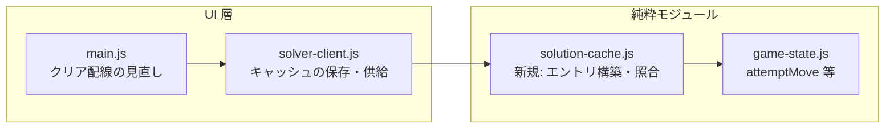

# 解法キャッシュ設計・実装計画（ソルバー結果の再利用）

## 1. 背景・目的

現在、ヒントボタン 1 回ごとに `src/js/solver-client.js` の `requestSolution()` が
Web Worker を新規起動し、その時点の盤面からフル探索を行う。

- 難盤面では数百万ノード・数十秒規模の CPU 時間を消費する
- モバイル環境ではバッテリー消費と発熱の直接原因になる
- 典型的なユースケースは「ヒント → その通りに 1 手動かす → ヒント → …」であり、
  前回の解の先頭を消費しているだけでも毎回フル探索が走る

本ドキュメントは、ソルバーの解をキャッシュして上記ループでの再探索をなくす仕組みの
**アーキテクチャと実装計画**を定める。採用するのは「解パス上の盤面スナップ照合による
遅延検証」方式である。

## 2. スコープ

### 2.1 要件

- 同一の解パス上であれば、次の状態ではキャッシュを維持する
  - 解に沿った前進（手動移動・自動ホーム送りを含む）
  - 解パス上へのアンドゥ、およびその後のやり直し
- 次の状態ではキャッシュを破棄する
  - 解パス外の盤面への逸脱
  - 解を求めた盤面（B0）より前への巻き戻し
- キャッシュから供給するヒントは、現在の盤面に対して常に合法であること
  （誤ったヒントは原理的に出せないこと）

### 2.2 非要件（スコープ外）

以下は初回実装には含めず、「7. 将来拡張」に記載する。

- localStorage / sessionStorage への永続化
- 失敗結果（node-limit / time-limit）のキャッシュ
- 複数ゲーム・複数盤面のキャッシュ保持（エントリは常に 1 つ）

## 3. 設計方針の決定事項

### 3.1 採用方式: 盤面スナップ照合による遅延検証

キャッシュには「解を求めた盤面 B0」と「解の適用途中の全盤面 B0…Bn」のスナップショット
列と手順配列を持つ。盤面が変わるたびにフラグを更新するのではなく、**ヒント要求時に
現在盤面をスナップ列と照合**し、一致すれば残り手順を返す。

利点:

- 盤面を変更する全経路（クリック / ドラッグ / ダブルクリック自動移動 / 自動ホーム送り /
  アンドゥ / リスタート / 新規ゲーム / テスト API `setBoard`）にフック不要。
  ヒント要求の一点だけで完結し、フラグ更新漏れによる誤ヒントのリスクが構造的に消える
- 「アンドゥで戻したら維持」「B0 より前に戻ったら破棄」が照合の失敗/成功として
  自動的に満たされる
- 逸脱後に偶然パス上の盤面へ戻った場合も自動的にキャッシュが復活する
- 正当性が自明: 現在盤面が Bj と完全一致するなら、残り手順 moves[j..] は
  実際に探索で検証済みの勝ち筋である

### 3.2 不採用: フラグ + 先頭削りのインクリメンタル管理

当初検討した「解法通り進んでいるかをフラグで持ち、ヒント時に先頭を削って返す」方式は
以下の理由で不採用とする。

- フラグ更新のためのフック箇所が多い（3.1 の全経路）。特に自動ホーム送りは
  `app.js` のアニメーション連鎖（`chainAutoNext()`）の中で 1 手ずつ行われるため、
  view のタイミングと絡んで取りこぼしやすい
- 「解法通り」の手一致判定は脆い。同じ盤面遷移でも空きフリーセルのどれを使うか等で
  手は一意ではなく、正当な進行なのに不一致扱いになる
- アンドゥの境界処理（パス上の戻しは維持、B0 越えは破棄）を自前で書くと複雑になる

### 3.3 既知の制限: アプリとソルバーの自動ホーム基準差

アプリ側の自動ホーム送りとソルバー内部の安全基準は完全には一致しない。

| 実装 | rank 1（A） | rank 2 | rank 3 以上 |
| --- | --- | --- | --- |
| アプリ `rules.canAutoHome` | 無条件で安全 | **無条件で安全** | 反対色が rank−1 以上 |
| ソルバー `isSafeFoundationMove` | 無条件で安全 | 反対色の A が home 済みが必要 | 反対色が rank−1 以上 |

この差により、ユーザーが解通りにプレイしていても、アプリの自動ホーム送りが
ソルバーの想定より先に ♦2 等を home へ送り、パス上のどの盤面とも一致しない状態が
生じ得る。これは**偽陽性（キャッシュの不要な破棄）**であり、正しさの問題ではない
（破棄されれば通常探索にフォールバックするだけ）。初回実装ではこれを許容し、
低減策は将来拡張とする（7.1）。

同様に、厳密な盤面比較では「空きフリーセルのどれを使うか」が違うだけの等価な進行も
不一致になる。これも不要な再探索（= 現状と同じコスト）にとどまるため許容する。

## 4. アーキテクチャ

### 4.1 コンポーネント配置



- `src/js/solution-cache.js`（新規）: キャッシュエントリの構築と照合のみを担う
  純粋モジュール。DOM・Worker・時刻に触れないため単体テストが容易
- `src/js/solver-client.js`: 解の受信時にエントリを保存し、要求時に照合して供給する
- `src/js/main.js`: 新規ゲーム系ボタンからの明示的クリア配線を見直す（5.3）

### 4.2 キャッシュエントリ

`solver-client.js` が単一のエントリを保持する。

```js
// {
//   boards: string[],  // boards[i] = i 手進んだ盤面のフィンガープリント
//                      // boards[0] = 解を求めた盤面 B0、boards[n] = 勝利盤面
//   moves: object[],   // moves[i] = boards[i] → boards[i+1] の 1 手
//                      // { cardId, fromZone, fromIndex, destZone, destIndex, count }
// }
```

- フィンガープリントは既存の `boardSnapshot()` と同じ
  `JSON.stringify({ cascades, freeCells, foundations })`（カード id 表現）を使う。
  正規化（列順のソート等）は行わない厳密比較とする（3.3 の方針）。
  実装上は solution-cache.js 側にフィンガープリント関数を置き、solver-client.js の
  `boardSnapshot()` もそれへ統合して二重実装を避ける
- エントリの構築は、B0 をカード id から復元したシャドウ state に対して
  `gameState.attemptMove()` で手順を再生し、各ステップ後にスナップを記録する形で行う。
  カードオブジェクトの復元は `app.js` の `setBoard` と同じ形式
  （`{ suit: id % 4, rank: Math.floor(id / 4) + 1, id }`）を使う
- 再生中に 1 手でも適用失敗・グループ長不一致（`groupFrom` の長さ ≠ `count`）が
  あればエントリを構築せず null を返し、キャッシュなしで動作する

メモリコストは解 1 本分（高々 ~150 手 × 52 要素の文字列 + 手順オブジェクト）で
数十 KB 程度であり、常駐させるのに十分小さい。

### 4.3 遅延検証フロー

ヒント要求時（`requestSolution()` 内、既存の計算中ガード `if (worker) { return; }`
の直後）に次を実行する。

1. 現在盤面のフィンガープリント F を計算する
2. キャッシュがなければ通常どおり Worker で探索する
3. `boards[]` を**末尾側から**線形探索し、F との一致位置 j を探す
   - 重複する一致がある場合は最も進んだ位置（最大 j）を採用する
   - `j === boards.length - 1`（勝利盤面）は供給対象外としてキャッシュを破棄する
4. 一致すれば残り手順 `moves[j..]` を返す
   - ヒント: Worker を起動せず同期で `showHintMove()` を呼ぶ（busy 表示も出さない）
   - 自動解答: 既存の Worker パスと同じ事前準備（`savedAutoMoveEnabled` の退避、
     `app.setAutoSolving(true)`、トグル ON、busy 表示）を行ってから
     `startAnimatedReplay(残り手順)` を呼ぶ。準備を省略すると再生開始時の
     UI 状態（自動ホーム送りの一時無効化など）が壊れる
5. 一致しなければキャッシュを破棄し、通常どおり Worker で探索する
6. Worker による解の受信時（既存の stale チェック通過後）に新しいエントリを保存する

Worker 計算中（`worker !== null`）の再要求は上記ガードで先に除外されるため、
キャッシュ照合は行われない。

### 4.4 供給時の防御チェック

キャッシュから返す 1 手目は、現在盤面に対して次を検証してから表示する。

1. `rules.findCardLocation()` でカードの現在位置を再解決する
2. 移動先の合法性を検証する（`canDropOnCascade` / 空きフリーセルの存在 /
   home は `foundationTargetFor` で再解決）
3. `count` は現在のグループ長から再計算する
4. 検証に失敗した場合はキャッシュを破棄し、通常探索にフォールバックする

これにより、フィンガープリント照合をすり抜ける不整合があっても誤ったヒントは
表示されない。home 行きの手は `gameState.attemptMove()` が別 home へ誘導するため、
自動ホーム送りとの軽微な食い違いはここで吸収される。

### 4.5 各操作経路での挙動

| 操作 | 盤面の変化 | 次のヒント要求時の判定 |
| --- | --- | --- |
| 解パス上の手を適用 | Bj → Bj+1 | 一致（残りが 1 手減る） |
| 自動ホーム送り（解と同じ進み） | パス上の盤面 | 一致 |
| 自動ホーム送り（3.3 の基準差で先行） | パス外の盤面 | 不一致 → 破棄（既知の偽陽性） |
| 空きフリーセル違いなど等価だが異なる手 | パス外の盤面 | 不一致 → 破棄（現状と同じコスト） |
| アンドゥ（パス上） | Bj−1 | 一致（残りが 1 手増える） |
| アンドゥ（B0 より前） | パス外の盤面 | 不一致 → 破棄 |
| 逸脱後に偶然パス上へ復帰 | Bj′ | 一致（キャッシュが復活） |
| リスタート（同番号） | B0 | 一致（全手順が復活し即答） |
| 新規ゲーム（別番号） | 別盤面 | 不一致 → 破棄 |
| テスト API `setBoard` | 任意の盤面 | 通常は不一致 → 破棄（一致すれば自己検証的に安全） |
| 自動解答の再生完了 | 勝利盤面 | 供給対象外 → 破棄 |

### 4.6 正当性の根拠

`boards[]` は B0 から勝利までの実際の合法手列である。したがって現在盤面が
Bj と完全一致する限り、`moves[j..]` を適用すれば必ず勝利でき、ゲーム番号や
それまでの経路に依存せずヒントとして正しい。この自己検証性により、
「別ゲームの盤面が偶然一致した」という極端なケースでも誤りにはならない。

## 5. 実装計画

### 5.1 Phase 1: `solution-cache.js`（純粋モジュール）

新規ファイル `src/js/solution-cache.js` に以下を実装する。

- `buildSolutionCacheEntry(startBoard, moves)`: シャドウ state 再生により
  `{ boards, moves }` を構築する。不整合時は null を返す
- `findProgressIndex(entry, board)`: 末尾側からの一致探索。見つからなければ -1
- `boardFingerprint(board)`: 盤面のフィンガープリント化。solver-client.js の
  `boardSnapshot()` をこれへ統合するため外部公開する（4.2）
- 内部ヘルパー: カード id からのカードオブジェクト復元

依存は `game-state.js` と `rules.js` のみとし、DOM・Worker に触れない。

### 5.2 Phase 2: `solver-client.js` への組み込み

- 未使用の `solution` 変数をキャッシュエントリで置き換える
- `clearSolution()` メソッドは参照元がなくなるため削除する（main.js 側の対応は 5.3）
- `requestSolution()` に 4.3 の照合フローを追加する
  - ヒントの同期供給パス（busy 表示なし・Worker 起動なし）
  - 自動解答のキャッシュヒットパス（4.3 の事前準備を行ってから
    `startAnimatedReplay()` を呼ぶ）
- Worker 結果の受信処理（stale チェック通過後）で `buildSolutionCacheEntry()` を呼び、
  成功時のみエントリを保存する
- 4.4 の防御チェックをヒント供給パスに実装する

### 5.3 Phase 3: `main.js` のクリア配線見直し

`clearSolutionOnNewGame()` 内の `solverClient.clearSolution()` 呼び出しのみを
削除する。同関数が担う他の後始末（自動解答の中断、トグル OFF、解答パネルと
ヒントの非表示）は新規ゲーム時に依然として必要なため、ボタンへの配線と関数自体は
維持する。キャッシュの寿命は盤面照合に一任され、リスタート後の即答（4.5）は
この変更で有効になる。

### 5.4 Phase 4: テスト

- 単体テスト: `tests/unit/solution-cache.test.js` を新規作成する（6.1）
- E2E テスト: `tests/e2e/freecell.spec.js` にシナリオを追加する（6.2）。
  キャッシュ状態の観測のため、`main.js` の公開テスト API
  （`getTestApi()`）にキャッシュ情報の取得関数を追加する
  （例: `solverCacheInfo()` → `{ active, remainingMoves }`）

### 5.5 Phase 5: ドキュメント更新

- `CHANGELOG.md` に本機能のエントリを追記する
- README.md の「機能」に、キャッシュ済みの解パス上ではヒントが即座に表示される旨を
  追記する

## 6. テスト計画

### 6.1 単体テスト（`tests/unit/solution-cache.test.js`）

| # | ケース | 期待結果 |
| --- | --- | --- |
| 1 | 正常な解手順からエントリ構築 | `boards[0]` が開始盤面、`boards[n]` が勝利盤面 |
| 2 | 不正手を含む手順でエントリ構築 | null を返しキャッシュ不成立 |
| 3 | 未着手盤面での照合 | インデックス 0 を返す |
| 4 | 途中盤面・勝利盤面での照合 | 対応インデックス / 最終インデックスを返す |
| 5 | パス外の盤面での照合 | -1 を返す |
| 6 | 重複する盤面での照合 | 最も大きいインデックスを返す |

### 6.2 E2E テスト（`tests/e2e/freecell.spec.js`）

テスト API のキャッシュ情報で観測する。

| # | ケース | 期待結果 |
| --- | --- | --- |
| 1 | ヒント → 従う → ヒント | 2 回目のヒントでキャッシュヒット（再探索なし） |
| 2 | ヒント → 解から外す → ヒント | キャッシュ破棄され再探索される |
| 3 | ヒント → 従う → アンドゥ → ヒント | キャッシュ維持（残り手数が元に戻る） |
| 4 | ヒント取得後にリスタート → ヒント | 即答（B0 一致で全手順復活） |
| 5 | ヒント取得後に新規ゲーム → ヒント | キャッシュ無効化 |

E2E でのソルバー実行は難盤面だと時間がかかるため、簡単に解けるゲーム番号を
フィクスチャとして指定する。

## 7. 将来拡張

### 7.1 自動ホーム飽和による正規化照合

比較前に「アプリ基準（`canAutoHome`）の自動ホーム送りを適用できる限り適用した」
盤面へ両者を正規化してから照合すると、3.3 の偽陽性を吸収できる。
home が先行しても残りの tableau 上の手の合法性は崩れないため、供給側の防御チェック
（4.4）と組み合わせれば安全に導入できる。

### 7.2 失敗結果のキャッシュ

ソルバーは決定的であるため、同一盤面の再ヒントは必ず同じ結果になる。
node-limit / time-limit による「見つからず」も status 込みでキャッシュすれば、
失敗後の連打による無駄な CPU 消費を防げる。

### 7.3 永続化

`dealGame()` は決定的なので、ゲーム番号をキーに localStorage へ退避すれば
ページリロード後もキャッシュが生きる。サイズは数 KB であり現実的だが、
メモリキャッシュのみで主要ユースケースはカバーできるため優先度は低い。

### 7.4 自動解答の計算中解除→再チェックでの計算継続

「自動解答トグル ON → **計算中**に OFF → 再度 ON」というフローでは、
`cancelAutoSolve()` が `stopWorker()` で Worker を terminate するため解が得られず、
キャッシュには何も残らない。再度 ON にすると同じ盤面に対して決定的なソルバーが
同一の探索を最初からやり直す（再生中の解除であればキャッシュにより即再開できる）。

改善案:

1. 計算中の解除では Worker を止めず、`activeRequest` に `background: true` を付けて
   UI のみアイドルへ戻す。結果を受信したら再生せずキャッシュへの保存のみ行う
2. 再度 ON にされたとき、バックグラウンド計算が進行中で盤面が変わっていなければ
   新規 Worker を起こさずそのリクエストを再アクティブ化する。
   盤面が変わっていれば既存の stale 判定で terminate して通常フローに落ちる

1+2 により「解除 → 再チェック」で常に無駄がゼロになる（計算中なら再接続、
完走済みならキャッシュヒット）。

トレードオフとして、ユーザーが明示的に停止した後も CPU を使い続ける
（最大 `maxTimeMs` = 180 秒）。バッテリー削減が本機能の目的であるため、
バックグラウンド継続に時間上限を設けるなどの割り切りが必要である。
実装コストは Worker ライフサイクル管理の追加だが、既存の `requestId` /
stale チェックの仕組みの延長で実現できる。

### 7.5 複数盤面のキャッシュ保持

本設計はエントリを常に 1 つに限定する（2.2）。ヒント主導のプレイでは直近に求めた
解だけ再利用できれば目的を達成するため、複数エントリは不要である。
複数ゲームを行き来する用途が生えた場合にのみ、「ゲーム番号 + 盤面照合」をキーとした
少数の LRU エントリへの拡張を検討する。照合方式（4.3）と防御チェック（4.4）は
エントリ数に依存しないため、拡張時に変更が必要なのはキャッシュの選択部分のみである。
